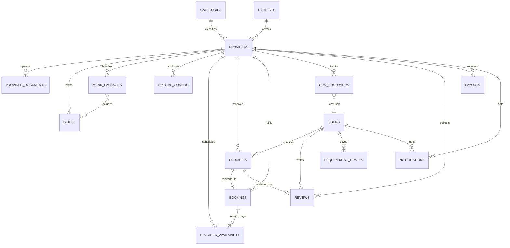

# 03 — Database Design (MongoDB / Mongoose)

Conventions: all schemas use `timestamps: true` (`createdAt`, `updatedAt`), `versionKey: false`, `strict: true`. Field names are camelCase. `ref` = ObjectId reference. "Day string" = `"YYYY-MM-DD"` (IST). Money = integer rupees. Replica set is required (transactions).

## 1. Relationship diagram

Embedded (not separate collections): enquiry `items[]`, `quote`, `timeline[]`; booking `payments[]`; CRM `notes[]`; review `providerReply`; category `eventTypes[]`/`services[]`; district `areas[]`.

---

## 2. Identity & session

### `users` (customers)
| Field | Type | Notes |
| :-- | :-- | :-- |
| `mobile` | String | **unique**, 10 digits, `/^[6-9]\d{9}$/` |
| `name` | String | null until profile setup |
| `whatsapp`, `altMobile` | String | optional |
| `district` | String | district name, e.g. `Salem` |
| `location` | String | locality, e.g. `Fairlands` |
| `geo` | `{lat:Number, lng:Number}` | last known GPS (from `PATCH /user/location`) |
| `avatarColor` | String | random from palette at profile creation |
| `profileCompleted` | Boolean | default false → drives `isNewUser` |
| `status` | `active \| blocked` | default `active` |
| `lastLoginAt` | Date | |

Indexes: `{mobile:1}` unique.

### `providers`
| Field | Type | Notes |
| :-- | :-- | :-- |
| `mobile` | String | **unique** |
| `whatsapp`, `email` | String | |
| `businessName`, `ownerName` | String | |
| `tagline`, `description` | String | |
| `logoColor` | String | default `#0E7C7B` |
| `coverImage` | String | file URL |
| `portfolioImages` | `[{url, caption?}]` | A6; "Previous Work" |
| `category` | enum | primary: `catering\|decoration\|audio\|makeup` |
| `secondaryCategories` | `[enum]` | excludes primary |
| `serviceDetails` | Mixed | per-category shape, see §2.1 |
| `vegPreference` | `veg\|non_veg\|both` | catering |
| `cuisineTypes` | `[String]` | catering |
| `minCapacity`, `maxCapacity` | Number | guests (catering/audio/decoration) or persons (makeup) |
| `maxDailyClients` | Number | makeup |
| `yearsActive` | Number | |
| `pricing` | `{model:'per_plate\|per_event\|fixed\|hourly', startingPrice:Number, advancePercentage:Number(default 30), cancellationPolicy:String, paymentTerms:String}` | |
| `coverage` | `{districts:[String], isAllDistricts:Boolean, areas:[String], travelsOutstation:Boolean, outstationFeePerKm:Number}` | |
| `district` | String | primary district (from step 1) |
| `geo` | `{lat, lng}` | D13 |
| `settings` | `{advanceNoticeDays:Number(3), autoAcceptEnquiries:Boolean(false)}` | |
| `status` | `draft\|pending\|under_review\|approved\|rejected\|suspended` | default `draft` |
| `rejectionReason`, `submittedAt`, `approvedAt`, `reviewedBy`, `termsAcceptedAt` | | |
| `registrationStep` | Number 1–7 | D18 |
| `completedSteps` | `[Number]` | which of 1–6 are saved |
| `verified` | Boolean | Q3 rule |
| `isOnline` | Boolean | default true |
| `isActive` | Boolean | default true (admin kill switch) |
| `rating` | Number | 0–5, 1 decimal |
| `ratingBreakdown` | `{1,2,3,4,5: Number}` | counts |
| `reviewCount` | Number | |
| `avgResponseMinutes` | Number | rolling, drives `responseTime` label |

Indexes: `{mobile:1}` unique; `{status:1,isActive:1,category:1}`; `{secondaryCategories:1}`; `{'coverage.districts':1}`; `{rating:-1}`; text index on `businessName, tagline, description, cuisineTypes` (plus escaped regex on `businessName` for partial search).

#### 2.1 `serviceDetails` by category
- `catering`: top-level `vegPreference`, `cuisineTypes`, `minCapacity`, `maxCapacity`, `yearsActive`.
- `makeup`: `{specialties:[String], bridalTrialOffered:Boolean, serviceLocation:'venue'|'home'|'venue_and_home'}` + top-level `maxDailyClients`, `yearsActive`; set `minCapacity=1`, `maxCapacity=maxDailyClients`.
- `decoration` / `audio`: `{specialties:[String]}` (optional) + optional `minCapacity/maxCapacity/yearsActive`.

### `provider_documents`
| Field | Notes |
| :-- | :-- |
| `providerId` ref | |
| `type` | `aadhaar\|pan\|gst\|trade_license\|fssai` |
| `numberEnc` | AES-256-GCM ciphertext of the number |
| `numberMasked` | `XXXX-XXXX-1098`, `XXXXX1234F`, … (this is what APIs return) |
| `fileUrl` | validated storage URL |
| `expiryDate` | day string (fssai) |
| `status` | `uploaded\|verified\|rejected` (`missing` is synthesized; `expired` is computed when `expiryDate < today`) |
| `rejectionReason`, `verifiedAt`, `verifiedBy` | |
| `lastReminderDays` | last expiry-reminder threshold sent (30/7/1), for the `documentExpiry` job |

Indexes: `{providerId:1,type:1}` unique.

### `otp_sessions`
`mobile`, `role`, `txnId` (unique), `otpHash` (bcrypt), `attempts` (max 5), `sendCount`, `windowStartedAt` (rate-limit window), `lastSentAt` (30 s cooldown), `expiresAt` (**TTL index**, `expireAfterSeconds:0`), `consumedAt`.
Indexes: `{mobile:1,role:1,createdAt:-1}`, `{txnId:1}` unique, TTL on `expiresAt`.

### `sessions` (refresh tokens + push tokens)
`subjectId`, `role`, `refreshHash` (sha256), `pushToken?`, `deviceInfo?`, `revokedAt?`, `expiresAt` (**TTL**, 30 days).
Indexes: `{subjectId:1,role:1}`, `{refreshHash:1}` unique, TTL.

### `admins`
`email` unique, `passwordHash`, `name`, `isActive`. Seeded from `ADMIN_EMAIL` / `ADMIN_PASSWORD` env.

---

## 3. Master data

### `categories` (`_id` = slug string: `catering|decoration|audio|makeup`)
`name`, `icon` (Ionicons), `providerIcon` (Lucide), `color`, `description`, `startingPriceHint` (number), `highlights:[String]`, `serviceScope:[String]`, `eventTypes:[String]`, `services:[String]`, `sortOrder`, `isActive`.

### `districts` (`_id` = slug: `salem`, `namakkal`…)
`name`, `isDefault` (Salem = true), `lat`, `lng` (centroid), `areas:[{name, type:'locality'|'taluk', lat?, lng?}]`, `isActive`. Seed all **38** TN districts; fully populate Salem, Namakkal, Erode (see doc 09 §5).

### `onboarding_slides`
`role` (`user|provider`), `order`, `title`, `subtitle`, `image`, `isActive`.

### `faqs`
`role` (`user|provider|both`), `question`, `answer`, `order`, `isActive`.

### `counters`
`_id` (`enquiry|booking|receipt|invoice|ticket`), `seq`. `nextCode()` uses `findOneAndUpdate({$inc})` and formats `ENQ-` / `BKG-` / `REC-` / `INV-` / `TKT-` + `100000+seq`.

---

## 4. Catalog

### `dishes`
`providerId`, `name`, `category` (slug: `starters|main|rice|curries|sweets|drinks|breads|non_veg|…` free-form lowercase), `price` (per plate/portion), `isVeg`, `isPopular`, `isActive`, `photoUrl`, `description?`.
Indexes: `{providerId:1,isActive:1,category:1}`.

### `menu_packages`
`providerId`, `name`, `description`, `pricePerPlate`, `minGuests`, `dishIds:[ref Dish]`, `isActive`, `isVeg` (computed on save: all dishes veg), `imageUrl?`.
Indexes: `{providerId:1,isActive:1}`.

### `special_combos`
`providerId`, `category`, `name`, `description`, `includedItems:[String]`, `price`, `originalPrice?`, `imageUrl`, `validUntil` (Date, end of IST day), `badge?`, `isActive`.
Indexes: `{isActive:1,validUntil:1}`, `{providerId:1}`.

### `provider_availability` (sparse: only non-default days)
`providerId`, `date` (day string), `status` (`blocked|booked`), `note?`, `bookingId?`.
Indexes: `{providerId:1,date:1}` **unique**. Setting a day to `available` **deletes** its doc.

---

## 5. Transactions

### `requirement_drafts`
`userId`, `payload` (validated requirement), `expiresAt` (**TTL**, 7 days). Returned `draftId` = `_id`.

### `enquiries`
| Field | Notes |
| :-- | :-- |
| `code` | `ENQ-100001`, unique |
| `userId`, `providerId` | refs |
| `customer` | snapshot `{name, mobile, whatsapp, email?, avatarColor}` |
| `providerSnapshot` | `{businessName, category}` |
| `category` | enum |
| `eventType`, `location`, `district` | strings |
| `eventDate`, `eventEndDate?` | day strings (`eventEndDate ≥ eventDate`) |
| `eventTime?` | A7 |
| `mealType?` | A7: `breakfast|lunch|dinner|snacks` |
| `guestCount` | Number |
| `makeupPersonsCount?`, `simultaneousStyling?`, `backupArtistAssigned?` | makeup |
| `staffing?` | `{leadArtists, backupArtists, hoursPerPerson:{min,max}, estimatedHours:{min,max}}` computed (doc 08 §5) |
| `items` | `[{dishId?, packageId?, name, price, qty}]` |
| `estimatedTotal` | Number, **server-computed** = Σ price×qty |
| `budgetMin?`, `budgetMax?` | from requirement |
| `notes?` | free text (provider calls it `special_requests`) |
| `status` | canonical (8 values, D6) |
| `quote?` | `{amount, validUntil?, inclusions:[String], terms?, message?, sentAt}` |
| `timeline` | `[{kind:'status'\|'message'\|'note', status?, author:'customer'\|'provider'\|'system', message, at}]` |
| `isNewLead` | true until provider first opens detail |
| `staleReminderSent` | Boolean, set by `staleEnquiry` job (doc 08 §9) |
| `firstRespondedAt?` | feeds response-rate/avg response time |
| `bookingId?`, `reviewId?`, `hasReview` | |
| `cancelledBy?`, `cancelReason?`, `rejectionReason?` | |

Indexes: `{code:1}` unique; `{providerId:1,status:1,createdAt:-1}`; `{userId:1,createdAt:-1}`; `{providerId:1,eventDate:1}`; `{providerId:1,'customer.mobile':1}`.

### `bookings`
`code`, `enquiryId` (unique), `providerId`, `userId`, `customer` snapshot, `category`, `eventType`, `eventDate`, `eventEndDate?`, `startTime?`, `venue`, `guestCount`, `totalAmount`, `advanceRequired`, `payments:[{_id, amount, method:'upi'|'cash'|'bank_transfer', referenceId?, notes?, receiptNo, paidAt}]`, `advancePaid` & `balanceDue` (denormalized, recomputed on every payment), `paymentStatus` (`unpaid|partially_paid|paid`), `status` (`confirmed|in_progress|completed|cancelled`), `invoiceUrl?`, `completedAt?`, `cancelledAt?`, `cancelledBy?`.
Indexes: `{providerId:1,status:1,eventDate:1}`, `{enquiryId:1}` unique, `{providerId:1,'payments.paidAt':1}`.

### `payouts` (admin-entered; read by provider Earnings)
`providerId`, `amount`, `status` (`pending|processing|completed|failed`), `method` (`direct_neft|upi`), `utrNumber?`, `payoutDate`, `periodFrom?`, `periodTo?`, `bookingIds:[ref]`.
Indexes: `{providerId:1,payoutDate:-1}`.

### `crm_customers`
`providerId`, `userId?`, `name`, `mobile`, `whatsapp?`, `email?`, `district?`, `city?`, `avatarColor`, `stage` (`new_lead|contacted|quoted|booked|completed|lost`), `totalEnquiries`, `totalBookings`, `totalSpent`, `lastEventDate?`, `lastContactAt`, `tags:[String]` (auto: `repeat|vip|high_value|recent`), `notes:[{_id, note, createdAt}]`.
Indexes: `{providerId:1,mobile:1}` **unique**; `{providerId:1,stage:1}`; `{providerId:1,lastContactAt:-1}`.

### `reviews`
`providerId`, `userId`, `enquiryId` (**unique** → one review per enquiry), `bookingId?`, `customerName`, `avatarColor`, `eventType`, `rating` (1–5), `ratings:{quality,communication,value,timeliness}` (default = `rating`), `comment`, `photos:[String]`, `providerReply?:{text, repliedAt}`, `status` (`published|hidden`).
Indexes: `{providerId:1,status:1,rating:1,createdAt:-1}`, `{enquiryId:1}` unique.

### `notifications`
`recipientRole` (`user|provider`), `recipientId`, `type` (`new_enquiry|quote_received|enquiry_update|booking|review|approval|document|system|promotion`), `title`, `message`, `isRead`, `referenceType?` (`enquiry|booking|review|provider|document`), `referenceId?`, `createdAt`.
Indexes: `{recipientRole:1,recipientId:1,isRead:1,createdAt:-1}`; TTL 180 days on `createdAt`.

### `support_tickets`
`code` (`TKT-…`), `role`, `subjectId` (user/provider id), `source` (`ticket|support_enquiry`), `subject`, `category` (`billing|technical|account|general`), `message`, `status` (`open|in_progress|resolved|closed`), `replies:[{by:'admin'|'requester', message, at}]`.

### `media_uploads`
`ownerRole`, `ownerId`, `category` (`provider_documents|dishes|combos|covers|portfolio|reviews|avatars`), `key`, `fileUrl`, `mimeType`, `status` (`pending|uploaded`), `localToken?` (dev driver), `expiresAt` (TTL on pending). Used to verify that any `file_url` a client submits was issued to **that** owner.

---

## 6. Index & integrity checklist

- Every provider-scoped collection has `providerId` as the **first** index key.
- Unique constraints: `users.mobile`, `providers.mobile`, `provider_documents{providerId,type}`, `provider_availability{providerId,date}`, `crm_customers{providerId,mobile}`, `reviews.enquiryId`, `bookings.enquiryId`, `enquiries.code`.
- Use `syncIndexes()` at startup in dev/test; in prod run once via a script flag (`SYNC_INDEXES=true`).
- Never delete `enquiries`, `bookings`, `reviews` (soft states only). Dishes/packages/combos may be hard-deleted; enquiry items keep snapshots (`name`, `price`), so history is safe.
